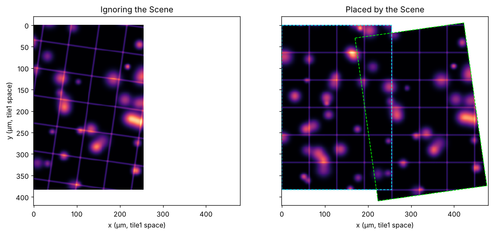

# clearscale examples

These examples are meant to show where clearscale fits in existing image code: You keep using your preferred array and zarr libraries for data, and clearscale keeps the multiscale metadata aligned with the shapes you produce.

Most examples assume you have `numpy`, `scikit-image` and `zarr-python 3.*` (and of course `clearscale`) installed.

### Downsample a numpy array and save as OME-Zarr multiscale

```python
import os, numpy, skimage, zarr

# Placeholders - plug in any zarr backend and image scaling method
my_data = numpy.random.rand(3, 12, 512, 512)
do_my_scaling = skimage.transform.resize
zarr_group = zarr.open_group(os.path.expanduser("demo-output/plan_first.ome.zarr"), mode="w")

import clearscale as cs

# 1. Define operation plan (the scaling "blueprint")
shape = cs.Shape(zip("tzyx", my_data.shape))
scaling_blueprint = cs.BlueprintShapes.downscale_powers_of_2_xyz(
    base_shape=shape,
    rounding="ceil",
    limit_all=cs.Shape(z=8, y=128, x=128),
)

# 2. Scale data according to the metadata
for scale_key, target_shape in scaling_blueprint.items():
    # Target shape from blueprint
    scaled_data = do_my_scaling(my_data, target_shape.values_tuple())
    # Target array path from blueprint
    zarr_group.create_array(scale_key, data=scaled_data)

# 3. Write metadata: Scale -> Multiscale -> Group -> attrs
pixel_size = cs.PixelSize(t=5.0, z=260.0, y=0.53, x=0.53)
unit       = cs.Unit(t="s", z="micrometer", y="micrometer", x="micrometer")
base       = cs.Scale(shape, pixel_size, unit)

ms = cs.Multiscale.from_single(
    base,
    blueprint=scaling_blueprint,
    pixel_sizing="shape_ratio",  # skimage.transform.resize scales pixel size by the shape ratio...
    translating="half_pixel_space_preservation",  # ...and preserves the image's extent
)
group_meta = cs.OmeZarrGroup.from_single(ms).to_attrs(version="0.6")
zarr_group.attrs.update(group_meta)
```

### Download a single scale of a public OME-Zarr as a valid local OME-Zarr

```python
from pathlib import Path
import zarr  # This example assumes zarr-python 3.* is installed (plus fsspec, requests and aiohttp for https reading)
import clearscale as cs

URL = "https://s3.embl.de/i2k-2020/platy-raw.ome.zarr"
SCALE_KEY = "s6"
LOCAL_PATH = Path(f"demo-output/platy-raw-{SCALE_KEY}.ome.zarr")

# 1. Discover what's on the server
remote_group = zarr.open_group(URL)

remote_meta = cs.OmeZarrGroup.from_group(remote_group)
assert remote_meta.kind is cs.GroupKind.MULTISCALE, "This tells us there is exactly one Multiscale in this group"
assert remote_meta.version == "0.4", "OME-Zarr version is a property of the group, not of individual Multiscales"

remote_multiscale = remote_meta.multiscales[0]
assert SCALE_KEY in remote_multiscale, "Multiscale is dict-like, with the sub-paths to arrays as keys"
assert remote_multiscale[SCALE_KEY].shape == {"z": 357, "y": 405, "x": 430}

# 2. Create the local target and download the data
source_array = remote_group[SCALE_KEY]
local_group = zarr.open_group(str(LOCAL_PATH), mode="w", zarr_format=2)  # OME-Zarr v0.4 must use zarr-format v2
print(f"Downloading {SCALE_KEY} data...")
local_array = local_group.create_array(SCALE_KEY, data=source_array)

# 3. Derive a new Multiscale from the chosen Scale entry in the existing Multiscale
local_multiscale = remote_multiscale.derive(SCALE_KEY)

# 4. Write the new metadata to the downloaded store
local_group_meta = cs.OmeZarrGroup.from_single(local_multiscale)
local_group.attrs.update(local_group_meta.to_attrs(version="0.4"))
```

## Add metadata to existing arrays

```python
import clearscale as cs

# zarr_group can be zarr-python, TensorStore-backed code, or your own wrapper.
# The only thing clearscale needs here is each array's shape.
scale_keys = ("s0", "s1", "s2")
recorded_shapes = [
    (scale_key, cs.Shape(zip("zyx", zarr_group[scale_key].shape)))
    for scale_key in scale_keys
]

base_scale = cs.Scale(
    shape=recorded_shapes[0][1],
    pixel_size=cs.PixelSize(z=0.5, y=0.25, x=0.25),
    unit=cs.Unit(z="micrometer", y="micrometer", x="micrometer"),
)

blueprint = cs.BlueprintShapes(recorded_shapes)
multiscale = cs.Multiscale.from_single(
    base_scale,
    blueprint=blueprint,
    # How were these arrays scaled? These values describe interpolating resizing, like skimage.transform.resize.
    pixel_sizing="shape_ratio",
    translating="half_pixel_space_preservation",
)

zarr_group.attrs.update(
    cs.OmeZarrGroup.from_single(multiscale).to_attrs(version="0.5")
)
```

Array shapes cannot reveal how the arrays were scaled, so clearscale cannot guess `pixel_sizing` and `translating` for you.
If you did not run the scaling yourself, or are unsure how it behaves, [characterize it](characterization.md).
For methods that scale by an exact factor (binning, striding), use a `BlueprintFactors` instead.

## Reuse a multiscale's scaling pattern for a new image

```python
import clearscale as cs

# Let's assume you have some existing Multiscale (maybe loaded by Multiscale.from_ome_zarr)
template = cs.Multiscale(
    {
        "s0": cs.Scale(
            shape=cs.Shape(c=1, z=64, y=1024, x=1024),
            pixel_size=cs.PixelSize(c=1, z=0.5, y=0.25, x=0.25),
            unit=cs.Unit(c="", z="micrometer", y="micrometer", x="micrometer"),
        ),
        "s1": cs.Scale(
            shape=cs.Shape(c=1, z=32, y=512, x=512),
            pixel_size=cs.PixelSize(c=1, z=1.0, y=0.5, x=0.5),
            unit=cs.Unit(c="", z="micrometer", y="micrometer", x="micrometer"),
        ),
        "s2": cs.Scale(
            shape=cs.Shape(c=1, z=16, y=256, x=256),
            pixel_size=cs.PixelSize(c=1, z=2.0, y=1.0, x=1.0),
            unit=cs.Unit(c="", z="micrometer", y="micrometer", x="micrometer"),
        ),
    }
)

target_base = cs.Scale(
    shape=cs.Shape(t=65, c=3, z=40, y=2048, x=2048),
    pixel_size=cs.PixelSize(t=0.5, c=1.0, z=0.7, y=0.1, x=0.1),
    unit=cs.Unit(t="seconds", c="", z="micrometer", y="micrometer", x="micrometer"),
)

blueprint = cs.BlueprintShapes.from_multiscale_rescaled(
    template,
    target_shape=target_base.shape,
    rounding="ceil",
).with_axes("tczyx")

# Describe how the new image's data will be scaled. These values are for interpolating resizing.
target_multiscale = blueprint.apply_to_scale(
    target_base,
    pixel_sizing="shape_ratio",
    translating="half_pixel_space_preservation",
)

assert target_multiscale["s0"].shape == cs.Shape(t=65, c=3, z=40, y=2048, x=2048)
assert target_multiscale["s1"].shape == cs.Shape(t=65, c=3, z=20, y=1024, x=1024)
assert target_multiscale["s2"].shape == cs.Shape(t=65, c=3, z=10, y=512, x=512)
```

You can also restrict the inherited scaling pattern to selected axes:

```python
xy_only = cs.BlueprintShapes.from_multiscale_rescaled(
    template,
    target_shape=target_base.shape,
    rounding="ceil",
    scaled_axes="yx",
)

assert xy_only["s2"] == cs.Shape(t=65, c=3, z=40, y=512, x=512)  # z not scaled
```

Or rebase from a non-root scale when your input data is already downsampled:

```python
rebased = cs.BlueprintShapes.from_multiscale_rescaled(
    template,
    target_shape=cs.Shape(c=3, z=20, y=1024, x=1024),
    source_key="s1",
    rounding="ceil",
)

assert rebased["s0"] == cs.Shape(c=3, z=40, y=2048, x=2048)
assert rebased["s1"] == cs.Shape(c=3, z=20, y=1024, x=1024)
assert rebased["s2"] == cs.Shape(c=3, z=10, y=512, x=512)
```

## Make `scipy.ndimage.affine_transform` match the metadata

`affine_transform` knows nothing about pixel sizes: Its `matrix` and `offset` alone decide where the output samples lie (`index_in = matrix * index_out + offset`).
With `matrix` equal to the scaling factor and `offset=0`, the output samples start at the first input sample and are spaced exactly `factor` apart (see [characterization](characterization.md)).
Resampling that preserves the extent of the data (like `skimage.transform.resize` does) needs the shape ratio as the matrix, and a half-pixel offset.

Instead of deriving these numbers by hand, clearscale can compute the metadata of the behaviour you want.
You can then take the arguments from the Scales, although a little additional arithmetic is still needed.

Source and output describe the same physical space, so for every axis, the source index of an output pixel is
`matrix * index_out + offset` with
* `matrix = target.pixel_size / base.pixel_size` and 
* `offset = (target.translation - base.translation) / base.pixel_size`

```python
import numpy as np
import clearscale as cs
from clearscale.characterization import half_pixel_space_preservation

base = cs.Scale(
    shape=cs.Shape(y=1001, x=1536),
    pixel_size=cs.PixelSize(y=0.3, x=0.3),
    unit=cs.Unit(y="micrometer", x="micrometer"),
)
blueprint = cs.BlueprintShapes.uniform_steps(
    step=2,
    base_shape=base.shape,
    rounding="round",
    limit_all=cs.Shape(y=250, x=384),
)

# The metadata that the extent-preserving resampling should produce:
multiscale = cs.Multiscale.from_single(
    base,
    blueprint=blueprint,
    pixel_sizing="shape_ratio",
    translating=half_pixel_space_preservation,
)

print(multiscale)
# Multiscale(
#     "s0" (y: 1001, x: 1536) at pixel size: y: 0.3 µm, x: 0.3 µm
#     "s1" (y: 500, x: 768) at pixel size: y: 0.6006 µm, x: 0.6 µm
#     "s2" (y: 250, x: 384) at pixel size: y: 1.2012 µm, x: 1.2 µm
# )

for scale_key, target in multiscale.items():
    shift = target.translation - base.translation
    matrix = (target.pixel_size / base.pixel_size).values_tuple()
    offset = tuple(shift[axis] / base.pixel_size[axis] for axis in shift)

    # Data scaling:
    # scaled = ndimage.affine_transform(
    #     raw_yx, matrix, offset=offset, output_shape=target.shape.values_tuple(), order=1
    # )

    if scale_key == "s1":
        assert np.allclose(matrix, (2.002, 2.0))
        assert np.allclose(offset, (0.501, 0.5))
```

Note the `2.002`: The base shape of 1001 does not halve evenly, so the output has 500 rows and the matrix is the exact ratio `1001 / 500`, not `2`.
Matrix and offset follow from the Scales, so data and metadata cannot drift apart.
Choose another `translating` function (or `pixel_sizing`) and the arguments change accordingly.

`affine_transform` interpolates between neighboring input samples, but it does not low-pass filter first, so strong downscaling will alias.
You would most likely want to smooth the data before you scale it, e.g. using `ndimage.gaussian_filter`.

To turn a matrix and offset that you already have into an `Affine` between two Scales, and vice versa, see the section on [Matrices in pixel index space](space.md#matrices-in-pixel-index-space).

## End to end: Two tiles that fit together in a Scene

A [Scene](scene.md) records how separate Multiscales relate to each other.
This example builds one from scratch, and checks that it is right by painting both images into one combined image.

Two tiles image neighboring parts of the same specimen.
The second was acquired with a stage that was rotated by 8°, and at a finer pixel size.
Both are stored as multiscale images, and the Scene stores the registration between them as an `Affine`.
If the Scene is right, the tiles agree where they overlap, and the gridlines of the specimen run straight across both.

```python
"""
End-to-end Scene example: Two microscope tiles that only form one image once the Scene is applied.

Requires numpy and zarr-python 3.* (and scipy + matplotlib for the final "display" step).
"""

import numpy as np
import zarr

import clearscale as cs
from clearscale.characterization import characterize_step_factor_scaling_method

# -----------------------------------------------------------------------------
# 1. A "specimen" that exists independently of any camera
# -----------------------------------------------------------------------------
# Blobs plus a faint 64 µm grid, defined for any physical coordinate (in µm).
# Two tiles will sample this at different positions, orientations and pixel sizes.
# If the Scene is right, the tiles can only fit together because the Scene is right.

rng = np.random.default_rng(seed=7)
blob_centers = rng.uniform((-20, -20), (440, 500), size=(80, 2))
blob_widths = rng.uniform(4, 12, size=80)
blob_heights = rng.uniform(0.4, 1.0, size=80)


def specimen(y, x):
    value = np.zeros_like(y, dtype=np.float64)
    for (cy, cx), width, height in zip(blob_centers, blob_widths, blob_heights):
        value += height * np.exp(-((y - cy) ** 2 + (x - cx) ** 2) / (2 * width**2))
    to_grid_line = lambda v: np.abs((v + 32) % 64 - 32)  # distance to the nearest multiple of 64
    value += 0.3 * np.exp(-to_grid_line(y) ** 2 / 4) + 0.3 * np.exp(-to_grid_line(x) ** 2 / 4)
    return value.astype(np.float32)


# -----------------------------------------------------------------------------
# 2. The microscope geometry (what we will pretend registration found out)
# -----------------------------------------------------------------------------
# tile1: axis-aligned, 384 x 256 pixels at 1.0 µm. Its physical space is our reference.
# tile2: 480 x 320 pixels at 0.8 µm, acquired with a stage that was rotated by 8 degrees
#        and positioned 30 µm down and 170 µm right.
#
# Each tile's pixel (i, j) sits at physical position (i, j) * pixel_size in the tile's own space
# (that's what a Scale without translation means). A relation maps physical coordinates of its source to
# physical coordinates of its target, so for tile2 --> tile1: `p_tile1 = R @ p_tile2 + t` (coordinates as y, x).

angle = np.deg2rad(8)
rotation = [
    [np.cos(angle), -np.sin(angle)],
    [np.sin(angle), np.cos(angle)],
]
shift_um = [30.0, 170.0]

tile2_to_tile1 = cs.Affine.from_linear_and_offset(rotation, shift_um, axes="yx")

tile1_base = cs.Scale(
    shape=cs.Shape(y=384, x=256),
    pixel_size=cs.PixelSize(y=1.0, x=1.0),
    unit=cs.Unit(y="micrometer", x="micrometer"),
)
tile2_base = cs.Scale(
    shape=cs.Shape(y=480, x=320),
    pixel_size=cs.PixelSize(y=0.8, x=0.8),
    unit=cs.Unit(y="micrometer", x="micrometer"),
)

# -----------------------------------------------------------------------------
# 3. Acquire the two tiles
# -----------------------------------------------------------------------------
yy, xx = np.indices(tile1_base.shape.values_tuple()) * 1.0
tile1_data = specimen(yy, xx)

# For tile2, take every pixel's own physical position and map it into tile1's space, where the specimen is defined:
tile2_yx = np.indices(tile2_base.shape.values_tuple()).reshape(2, -1).T * 0.8
in_tile1_space = tile2_yx @ np.array(rotation).T + np.array(shift_um)
tile2_data = specimen(in_tile1_space[:, 0], in_tile1_space[:, 1]).reshape(tile2_base.shape.values_tuple())


# -----------------------------------------------------------------------------
# 4. Our scaling method, and what it does to the metadata
# -----------------------------------------------------------------------------
def block_mean(array, factor):
    """Mean of each block of `factor` samples along every axis. Blocks at the end may be partial."""
    if factor != int(factor) or factor < 1:
        raise ValueError(f"Block size must be a positive integer, got {factor}")
    size = int(factor)
    result = np.asarray(array, dtype=np.float64)
    for axis in range(result.ndim):
        starts = np.arange(0, result.shape[axis], size)
        counts = np.diff(np.append(starts, result.shape[axis]))
        sums = np.add.reduceat(result, starts, axis=axis)
        result = sums / counts.reshape([-1 if a == axis else 1 for a in range(result.ndim)])
    return result


# We can not assume how the method rounds output shapes, spaces pixels, or shifts them. Ask the method itself:
characterization = characterize_step_factor_scaling_method(block_mean)
assert characterization.rounding == "ceil"
assert characterization.pixel_sizing == "exact_factor"
assert characterization.translating.__name__ == "discrete_bin_center"


def multiscale_and_levels(base_scale, base_data):
    """Metadata first: The blueprint decides which factors exist, and then also drives the scaling of the data."""
    blueprint = cs.BlueprintFactors.uniform_steps(
        step=2, base_shape=base_scale.shape, rounding=characterization.rounding, max_levels=3
    )
    multiscale = blueprint.apply_to_scale(base_scale, **characterization.to_factor_kwargs())
    levels = {key: block_mean(base_data, factor["y"]) for key, factor in blueprint.items()}

    for key, level in levels.items():
        assert level.shape == multiscale[key].shape.values_tuple()  # What we predicted is what we got
        # Pixel positions, checked against the data: Scale the coordinates the same way as the pixels.
        # (A partial last block cannot sit on the regular pixel grid, so only compare the complete ones.)
        factor = int(blueprint[key]["y"])
        full_blocks = base_scale.shape["y"] // factor
        centers = block_mean(np.arange(base_scale.shape["y"]) * base_scale.pixel_size["y"], factor)[:full_blocks]
        positions = multiscale[key].translation["y"] + multiscale[key].pixel_size["y"] * np.arange(full_blocks)
        assert np.allclose(centers, positions)
    return multiscale, {key: level.astype(np.float32) for key, level in levels.items()}


tile1, tile1_levels = multiscale_and_levels(tile1_base, tile1_data)
tile2, tile2_levels = multiscale_and_levels(tile2_base, tile2_data)

# -----------------------------------------------------------------------------
# 5. The Scene: how tile2 relates to tile1
# -----------------------------------------------------------------------------
scene = cs.Scene.from_multiscale_pair(
    a=tile2,
    b=tile1,
    a_to_b=tile2_to_tile1,
    a_path="tile2",
    b_path="tile1",
)

# -----------------------------------------------------------------------------
# 6. Write it
# -----------------------------------------------------------------------------
levels_by_path = {"tile1": tile1_levels, "tile2": tile2_levels}

root = zarr.open_group("demo-output/two_tiles.ome.zarr", mode="w", zarr_format=3)
root.attrs.update(cs.OmeZarrGroup.from_single(scene).to_attrs(version="0.6"))

# The Scene says where its Multiscales live. Create exactly those groups.
for path, multiscale in scene.multiscale_paths.items():
    group = root.require_group(path)
    group.attrs.update(cs.OmeZarrGroup.from_single(multiscale).to_attrs(version="0.6"))
    for scale_key in multiscale:
        group.create_array(scale_key, data=levels_by_path[path][scale_key])

print("Wrote demo-output/two_tiles.ome.zarr")

# -----------------------------------------------------------------------------
# 7. Read it back, the way another program would
# -----------------------------------------------------------------------------
root = zarr.open_group("demo-output/two_tiles.ome.zarr", mode="r")
loaded = cs.OmeZarrGroup.from_group(root).scenes[0]
loaded = loaded.with_resolved(
    {path: cs.OmeZarrGroup.from_group(root[path]).multiscales[0] for path in loaded.unresolved_paths}
)
loaded_tile1, loaded_tile2 = loaded.multiscale_paths["tile1"], loaded.multiscale_paths["tile2"]

# The relation comes back in canonical form. OME-Zarr stores the rotation and the shift as separate transforms,
# so this is a sequence of two steps, not necessarily the single Affine we passed in.
relation = loaded.relation_from(loaded_tile2, to=loaded_tile1)
steps = tuple(relation) if isinstance(relation, cs.SpatialRelationSequence) else (relation,)

# For resampling we want one matrix: Multiply the steps together as homogeneous matrices (later steps on the left).
total = np.eye(3)
for step in steps:
    affine = step if isinstance(step, cs.Affine) else cs.Affine(translation=step)
    total = np.array(affine.to_lists_homogenous()) @ total
tile2_to_canvas = cs.Affine.from_array(total[:2], axes="yx")

# -----------------------------------------------------------------------------
# 8. Display the Scene as a whole
# -----------------------------------------------------------------------------
# Paint both tiles onto one canvas. We choose its grid: 1 µm pixels covering y in [-20, 420), x in [0, 480)
# of tile1's space.
from scipy import ndimage

canvas = cs.Scale(
    shape=cs.Shape(y=440, x=480),
    pixel_size=cs.PixelSize(y=1.0, x=1.0),
    unit=cs.Unit(y="micrometer", x="micrometer"),
    translation=cs.Translation(y=-20.0, x=0.0),
)


def paint(array, scale, onto_canvas):
    """Resample `array` (described by `scale`) onto the canvas. `onto_canvas` maps its space to the canvas's."""
    # scipy wants "pull" arguments: For each canvas pixel, where in the array to look.
    # That is the inverse relation, expressed in pixel indices (see "Matrices in pixel index space").
    matrix, offset = onto_canvas.inverted().to_linear_and_offset(source=canvas, target=scale)
    return ndimage.affine_transform(
        array, np.array(matrix), offset=offset, output_shape=canvas.shape.values_tuple(), order=1, cval=np.nan
    )


# tile1's space *is* the canvas space (up to the canvas origin), tile2 reaches it through the Scene.
painted1 = paint(tile1_levels["s0"], loaded_tile1["s0"], cs.Affine.identity("yx"))
painted2 = paint(tile2_levels["s0"], loaded_tile2["s0"], tile2_to_canvas)

# Where both tiles cover the canvas they should show the same specimen:
both = ~np.isnan(painted1) & ~np.isnan(painted2)
print(f"Overlap: {both.sum()} pixels, max difference {np.abs(painted1 - painted2)[both].max():.3f}")
assert both.sum() > 5000 and np.abs(painted1 - painted2)[both].max() < 0.1

# And both should match the specimen itself, sampled directly at the canvas pixels:
canvas_y, canvas_x = np.indices(canvas.shape.values_tuple())
truth = specimen(canvas_y - 20.0, canvas_x)
for painted in (painted1, painted2):
    covered = ~np.isnan(painted)
    assert np.abs(painted - truth)[covered].max() < 0.1

mosaic = np.where(np.isnan(painted2), painted1, painted2)

# For contrast: The same two images if we ignored the Scene (tile2 treated as if it were in tile1's space).
ignoring = paint(tile2_levels["s0"], loaded_tile2["s0"], cs.Affine.identity("yx"))
mosaic_ignoring_scene = np.where(np.isnan(ignoring), painted1, ignoring)

import matplotlib

matplotlib.use("Agg")
import matplotlib.pyplot as plt


# Tile outlines: tile1's corners are already in canvas space, tile2's go through the Scene's relation.
def outline(scale, to_canvas):
    corners = np.array([(0, 0), (0, 1), (1, 1), (1, 0), (0, 0)]) * (np.array(scale.shape.values_tuple()) - 1)
    physical = corners * np.array(scale.pixel_size.values_tuple()) + np.array(scale.translation.values_tuple())
    linear, offset = to_canvas.to_linear_and_offset()
    return physical @ np.array(linear).T + np.array(offset)


fig, axes = plt.subplots(1, 2, figsize=(12, 6), sharey=True)
extent = (-0.5, 479.5, 419.5, -20.5)  # canvas pixel edges: x_min, x_max, y_max, y_min
for ax, image, title in (
    (axes[0], mosaic_ignoring_scene, "Ignoring the Scene"),
    (axes[1], mosaic, "Placed by the Scene"),
):
    ax.imshow(image, extent=extent, cmap="magma", interpolation="nearest")
    ax.set_title(title)
    ax.set_xlabel("x (µm, tile1 space)")
axes[0].set_ylabel("y (µm, tile1 space)")
for outline_yx, color in (
    (outline(loaded_tile1["s0"], cs.Affine.identity("yx")), "cyan"),
    (outline(loaded_tile2["s0"], tile2_to_canvas), "lime"),
):
    axes[1].plot(outline_yx[:, 1], outline_yx[:, 0], color=color, linewidth=1, linestyle="--")
fig.savefig("demo-output/two_tiles.png", dpi=110, bbox_inches="tight")
```

Running it writes `demo-output/two_tiles.ome.zarr` and a picture like this:



* *Ignoring the Scene*, tile 2 is just another array: Its pixels have no connection to tile 1.
* *Placed by the Scene*, the tiles are one image. Dashed outlines show where each tile is, and the second is tilted.

Things to notice:

* **Describe your scaling method by characterizing it.**
  `block_mean` bins pixels, so the output pixel size is exactly the factor times the input's, the first output pixel is centered over its first bin, and a partial last bin rounds up.
  Array shapes cannot reveal that, so the example asks the scaling function itself (see [characterization](characterization.md)), and passes the result on with `to_factor_kwargs()`.
  For these evenly divisible shapes, a `BlueprintShapes` would give identical metadata, but only a `BlueprintFactors` can express an exact factor for any shape.
* **The blueprint drives the data.**
  Which levels exist, and the shape of each array, come from the blueprint, and the data is scaled with the blueprint's factors.
  The example checks the result: The arrays have the predicted shapes, and scaling the pixel coordinates with the same function lands on the positions that the metadata describes.
* **The relation maps physical coordinates, source to target.**
  `tile2_to_tile1` takes a position in tile 2's space (in µm, so pixel size is already accounted for) to the same position in tile 1's space.
  The arrays could have any pixel size, and the Affine would not change.
  Build it with `Affine.from_linear_and_offset`, or `Affine.from_array` for a single `[matrix | offset]` array.
* **Write the Multiscales where the Scene says.**
  Iterating `scene.multiscale_paths` means the layout cannot drift from the Scene's own metadata.
* **Relations come back in canonical form.**
  OME-Zarr stores rotation and translation as separate transforms, so the relation you read back is a sequence of two steps, though you passed one `Affine`.
  The few lines that multiply the steps into a single `Affine` are all that is needed to use it as a matrix.
* **Resampling libraries want the inverse in index space.**
  `scipy.ndimage.affine_transform` asks, for each *canvas* pixel, where to look in the *input* array, so `paint` inverts the relation and swaps source and target grids.
  See [Matrices in pixel index space](space.md#matrices-in-pixel-index-space) for why.
* **Checks that can fail.**
  The assertions compare the painted tiles to each other, and to the specimen sampled directly.
  If you change the angle in the Scene only (say to 9°), they fail: The metadata is what makes the tiles fit.

If your tiles are only translated against each other, `Scene.from_shared_coordinate_system` is the natural alternative (see [Shared space: tiles](scene.md#shared-space-tiles)).
