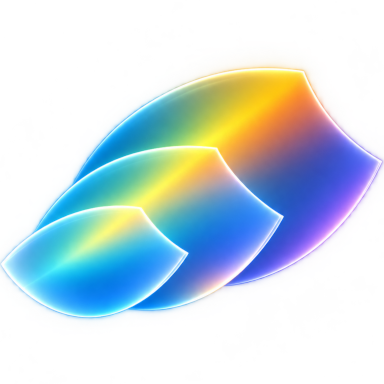

#  clearscale

clearscale is a dependency-free Python library for reading, working with, and writing multiscale image metadata.

You load and process the image arrays with your preferred tools;
clearscale helps you handle the metadata, and takes over serialization and deserialization.

## Features

* Zero dependencies, pure Python
* Compatible with Python 3.10+
* Read all OME-Zarr versions (0.1 to 0.6) using one code path - no specific handling per version (unless you want to)
* Write OME-Zarr versions 0.4, 0.5 and 0.6
* Read Neuroglancer Precomputed metadata (very basic support)

### Highlights

* Ensure accurate multiscale metadata by [characterizing](characterization.md) your scaling method
* Read and write multiscale transformations into alternate [coordinate systems](space.md) (OME-Zarr 0.6)
* Read and write transformations between multiscales using [scenes](scene.md) (OME-Zarr 0.6)

## Install

`clearscale` is considered in "beta" status (0.9) for a short time, with 1.0 release intended soon(TM), when we have some feedback from first users.

Please try it and let us know if you encounter anything unclear!

Install from PyPI:

```bash
pip install clearscale==0.9.0rc3
```

Or using conda:

```bash
conda install -c btbest clearscale==0.9.0rc3
```

Until 1.0, the API is considered subject to change so we can ensure it "solidifies" with as much convenience and robustness as possible.
We hope there won't be too many changes necessary at this point.

## Minimal OME-Zarr example

This writes a single numpy array as OME-Zarr.
The absolute minimum requirements:

* axis keys (`"zyx"`)
* writing the data to a zarr *array* inside a zarr *group* (and recording the array sub-path)

```python
# Assuming you have numpy and zarr-python 3.* installed
import numpy as np
import zarr
import clearscale as cs

# You have some array
image = np.random.random((128, 1024, 1024)).astype(np.float32)

# 1. Data: Make a group and write the array into it
# (no clearscale involved)
group = zarr.open_group(
    "demo-output/minimal.ome.zarr",
    mode="w",
)
array_path = "s0"
group.create_array(array_path, data=image)

# 2. Metadata: Scale -> Multiscale -> Group -> attrs
group.attrs.update(
    cs.OmeZarrGroup  # Group = one zarr group's OME metadata
    .from_single(
        cs.Multiscale.from_single(  # Multiscale = an image
            scale=cs.Scale.from_lists("zyx"),  # Scale = an array
            scale_key=array_path
        )
    )
    .to_attrs(version="0.5")
)
```

## Overview

Start with [OME-Zarr](ome_zarr.md) to add metadata support to an existing image-processing tool or script that uses zarr.

- [Basics](basics.md) for the core types: axis values, scaling blueprints, scales, and multiscales.
- [Scaling methods](characterization.md): Choose the right rounding, pixel size, and translation behavior for your scaling method.
- [Coordinate systems](space.md): Describe spatial context and relations between coordinate systems.
- [Scenes](scene.md): Relate several multiscales, for example after registration or stitching.

Or refer to the full automatically generated API Reference to look up individual classes and methods.

## Copy-and-paste examples

The [examples page](examples.md) includes some complete scripts for creating real OME-Zarr datasets.

## Contributing

Feedback, questions, bug reports, feature requests, and contributions are welcome!
See the [contribution guide](https://github.com/ilastik/clearscale/blob/main/CONTRIBUTING.md) for development instructions and the planned feature scope.

## License

Licensed under either the [MIT license](https://github.com/ilastik/clearscale/blob/main/LICENSE-MIT) or the [Apache License, Version 2.0](https://github.com/ilastik/clearscale/blob/main/LICENSE-APACHE), at your option.
